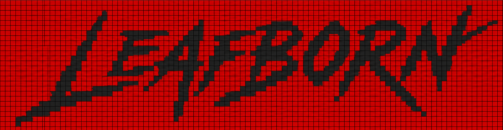
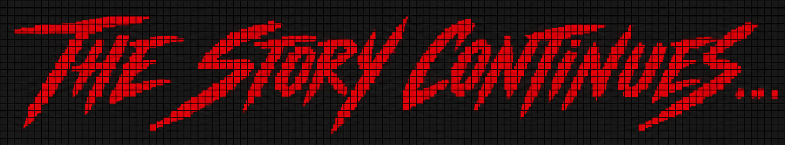

<h1 align="center">Hi 👋, I'm Abhay Vishwakarma</h1>
<h3 align="center">LeafBorn | B.Tech Student | AI/ML Engineer with hands-on experience in Python, PyTorch, Deep Learning, Scikit-learn, NLP, LLMs, LangChain, Hugging Face, Computer Vision, OpenCV, Streamlit, SQL, and Git.</h3>

<p align="center">
  
</p>

<!-- Snake Game Repo View -->

<div align="center">
  
</div>

## About Me 

```python
class LeafBorn:
    def __init__(self):
        self.alias       = ["Abhay"]
        self.role        = "AI/ML Engineer"
        self.focus       = ["Machine Learning", "Large Language Models", "RAG","Python Development"]
        self.languages   = ["Python", "SQL", "C"]

    def current_mission(self):
        return "Become a Machine Learning Engineer and build impactful AI products."

    def operational_status(self):
        return "Learning | Building | Open Source | LeetCode"
```
---


- 🔭 Building (Pixxie V.2) a custom GPT-style LLM from scratch [Pixxie-version-2.0](Pixxie-version-2.0)

- ⚡QuarkLlama (0.5B) — Custom PyTorch LLM & Real-Time Web-Grounded AI Companion.[Quark](https://github.com/LeafBorn/Quark))

- 🎥 A complete Multi-Agent AI Research Pipeline built using LangChain + LLMs + Tavily + BeautifulSoup [Research-Labs](https://github.com/LeafBorn/Research-Labs)

-  🤖 Minimalist, High-Performance 4K AI Video & Image Super-Resolution System [NEURAL SUPER RESOLUTION ENGINE](https://github.com/LeafBorn/-NEURAL-SUPER-RESOLUTION-ENGINE)

- 👨‍💻 All of my projects are available at [https://github.com/LeafBorn?tab=repositories](https://github.com/LeafBorn?tab=repositories)

- 🧩 Connect with me [https://www.linkedin.com/in/leafborn/](https://www.linkedin.com/in/leafborn/)

- 🌱 400+ DSA problems solved on LeetCode [https://leetcode.com/u/LeafBorn/](https://leetcode.com/u/LeafBorn/)

- 📫 How to reach me **abhaycoder10301@gmail.com**

<h3 align="left">Connect with me:</h3>

<p align="center">
  <a href="https://github.com/LeafBorn">
    
  </a>
  &nbsp;&nbsp;&nbsp;
  <a href="https://www.linkedin.com/in/leafborn/">
    
  </a>
  &nbsp;&nbsp;&nbsp;
  <a href="abhaycoder10301@gmail.com">
    
  </a>
  &nbsp;&nbsp;&nbsp;
 <a href="https://www.leetcode.com/leafborn">
  
</a>
&nbsp;&nbsp;&nbsp;
<a href="https://portfolio-q6gs.onrender.com/">
  
</a>
&nbsp;&nbsp;&nbsp;
</p>


## 🧠 Tech Stack  

---


<table>
  <tr>
    <td valign="top" width="33%">
      <h3>Machine Learning</h3>
      <p>
        
        
        
        
        
        
        
        
      </p>
    </td>
    <td valign="top" width="33%">
      <h3>Generative AI & LLMs</h3>
      <p>
        
        
        
        
        
        
        
        
        
      </p>
    </td>
    <td valign="top" width="33%">
      <h3>MLOps & Production</h3>
      <p>
        
        
        
        
        
        
      </p>
    </td>
  </tr>
</table>

---


## 📊 GitHub Stats  


<div align="center">
  
  
</div>

</div>


<br/>

